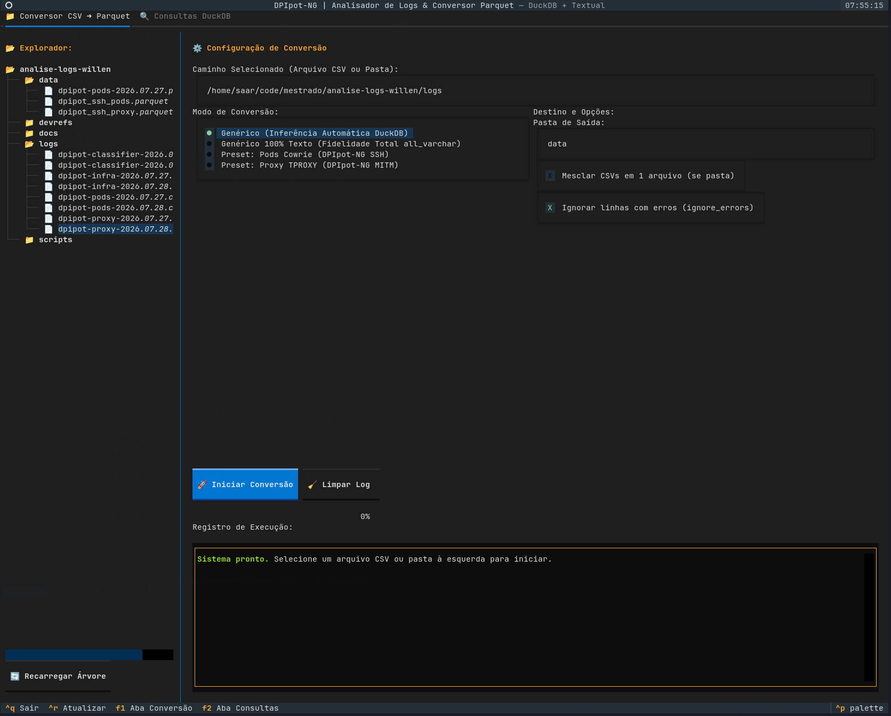

# dpipot-analytics(1) — TUI Log Processor & DuckDB Query Engine

```
       ___       _             _                             _       _   _
    __| _ \_ _  (_)_ __  ___ _| |_      __ _ _ _  __ _ | |_  _ __| |_(_)__ ___
   / _` |  _/ | | | '_ \/ _ \_  __|    / _` | ' \/ _` || | || (_-<  _| / _(_-<
   \__,_|_| |_| |_| .__/\___/ |_|      \__,_|_||_\__,_||_|\_, /__/\__|_\__/__/
                  |_|                                     |__/
```

> Out-of-core streaming CSV-to-Parquet conversion and interactive SQL workspace for network telemetry and honeypot forensics.

---



---

## SYNOPSIS

```bash
# Interactive Terminal User Interface
python tui.py
python scripts/tui.py

# Headless Batch Extraction (SSH Cowrie + Proxy MITM)
python scripts/extrair_ssh_parquet.py

# Figure Generation (Matplotlib + Seaborn)
python scripts/analisar_resultados.py

# One-liner ad-hoc query via DuckDB CLI/Python
python -c "import duckdb; duckdb.sql('SELECT COUNT(*) FROM read_parquet(\"data/dpipot_ssh_proxy.parquet\")').show()"
```

---

## DESCRIPTION

`dpipot-analytics` is a terminal-native tool designed to process large raw security logs (~160 GB in CSV format, >210 million events) collected from the DPIpot-NG honeypot orchestrator deployed on the RNP academic backbone.

Traditional data manipulation tools (e.g., pandas) fail on datasets of this size due to memory allocation limits (`OutOfMemoryError`). This project replaces row-oriented CSV parsing with an out-of-core, vectorized columnar pipeline powered by **DuckDB**, **Apache Parquet (Zstandard)**, and **Textual**.

### Key Technical Capabilities:

* **Streaming Ingestion**: Reads CSV inputs in multi-threaded 122k-tuple blocks in C++, pushing down projection and filter predicates before memory allocation.
* **Lossless Storage Reduction**: Compresses ~160 GB of repetitive text logs down to ~1-2 GB via columnar dictionary encoding and Zstandard compression.
* **Non-blocking TUI**: Workers execute heavy disk operations on background threads, keeping the interface responsive with live telemetry (elapsed time, row count, compression factor).
* **Embedded SQL Console**: Evaluates arbitrary ANSI SQL queries over Parquet datasets in milliseconds, rendering results in a scrollable, memory-capped data table.

---

## KEYBINDINGS

All actions are bound to the keyboard.

| Keybinding | Context | Action |
| :--- | :--- | :--- |
| `F1` | Global | Switch to Converter tab (CSV -> Parquet) |
| `F2` | Global | Switch to SQL Explorer tab (DuckDB) |
| `Ctrl + Enter` | SQL Editor | Execute query |
| `Ctrl + R` | Global | Refresh directory tree and Parquet datasets |
| `Ctrl + Q` | Global | Exit application |
| `Tab` / `Shift + Tab` | Global | Cycle widget focus |
| `Up` / `Down` / `Left` / `Right` | Tree / Table | Navigate rows, cells, and file nodes |

---

## INGESTION MODES

The conversion engine supports four operational profiles:

1. **Generic (Automatic)**
   Uses DuckDB `read_csv_auto` to sniff column types, delimiters, and header names automatically.

2. **Generic 100% Text (`all_varchar=true`)**
   Reads all fields as raw strings. Guarantees zero data loss and prevents coercion errors on heterogeneous or malformed log lines.

3. **Preset: Pods Cowrie (SSH)**
   Applies domain-specific filters (`protocol = 'ssh'`, `eventid LIKE 'cowrie%'`) and extracts timestamps, sessions, source/destination sockets, HASSH fingerprints, and shell execution commands (`CMD:`).

4. **Preset: Proxy TPROXY (MITM)**
   Extracts edge network flows, true attacker IPs, country/city geolocation, ASN metadata, TCP window sizes, TTLs, and intercepted credentials.

5. **Merge Mode (`union_by_name=true`)**
   Consolidates multiple CSV files from a directory into a single unified Parquet dataset.

---

## INSTALLATION & SETUP

The project targets Python >= 3.10 and is managed via `uv`.

### Method A: Using `uv` (Recommended)

```bash
# Clone and enter directory
cd analise-logs-willen

# Install dependencies into environment
uv pip install -r requirements.txt
```

### Method B: Using standard Python venv

```bash
python3 -m venv .venv
source .venv/bin/activate
pip install -r requirements.txt
```

### Core Dependencies:
* `duckdb >= 1.1.0` (vectorized query execution engine)
* `textual >= 0.70.0` (asynchronous terminal user interface framework)
* `pyarrow >= 17.0.0` (Apache Parquet bindings)
* `polars >= 1.0.0` (high-performance columnar manipulation)
* `rich >= 13.7.0` (terminal formatting and renderables)

---

## PIPELINE ARCHITECTURE

```
+-------------------------------------------------------------------------+
| RAW DATA LAYER (DISK)                                                   |
| ~160 GB CSV Files (dpipot-pods, dpipot-proxy, dpipot-classifier)         |
+-------------------------------------------------------------------------+
                                     |
                                     | (1) Multi-threaded block streaming
                                     v
+-------------------------------------------------------------------------+
| DUCKDB ENGINE (IN-PROCESS C++)                                          |
| - Projection pushdown (drops unused columns during read)                |
| - Predicate pushdown (evaluates WHERE filters before allocation)        |
| - Out-of-core disk spill if RAM threshold is exceeded                   |
+-------------------------------------------------------------------------+
                                     |
                                     | (2) Columnar dictionary + ZSTD encoding
                                     v
+-------------------------------------------------------------------------+
| STORAGE LAYER (PARQUET)                                                 |
| 1-2 GB compressed files (.parquet)                                      |
| data/dpipot_ssh_pods.parquet | data/dpipot_ssh_proxy.parquet            |
+-------------------------------------------------------------------------+
                                     |
                                     | (3) Sub-second vectorized SQL execution
                                     v
+-------------------------------------------------------------------------+
| CONSUMPTION INTERFACES                                                  |
| - Terminal UI (tui.py)                                                  |
| - Automated Figures (scripts/analisar_resultados.py)                    |
| - Jupyter / Ad-hoc Shell Analytics                                      |
+-------------------------------------------------------------------------+
```

---

## REPOSITORY TREE

```
.
|-- tui.py                      # Root launcher for the TUI application
|-- requirements.txt            # Package manifest
|-- data/                       # Parquet storage directory
|   |-- dpipot_ssh_pods.parquet
|   `-- dpipot_ssh_proxy.parquet
|-- docs/                       # Research documentation and figures
|   |-- tui_shot.png            # TUI interface capture
|   |-- grafico_top_paises.png  # Generated research figures
|   |-- grafico_top_senhas.png
|   |-- guia_ambiente_e_execucao.md
|   |-- hipotese_e_correlacao_multicamadas.md
|   `-- relatorio_orientadora_mestrado.md
`-- scripts/
    |-- tui.py                  # Full Textual + DuckDB application code
    |-- extrair_ssh_parquet.py  # CLI batch extraction script
    `-- analisar_resultados.py  # Plotting routines for academic output
```

---

## MULTILAYER CORRELATION MODEL

This pipeline supports research on end-to-end threat attribution by bridging three telemetry planes:

```
Layer 4: Transport (Network / OS Stack)
         Source: dpipot-classifier & dpipot-proxy
         Metrics: TCP Window Size, TTL, DF Flag, MSS

Layer 5/6: Session & Cryptography (Client Library)
         Source: dpipot-pods (Cowrie)
         Metrics: HASSH = MD5(kexAlgs || encCS || macCS || compCS)

Layer 7: Application & Intent (Adversary Actions)
         Source: dpipot-pods (Cowrie)
         Metrics: Intercepted credentials, command sequences, payload drops
```

Connecting edge MITM proxy logs with honeypot application logs preserves transport fingerprints that would otherwise be masked by TCP termination, enabling accurate classification of brute-force botnets and targeted campaigns.
